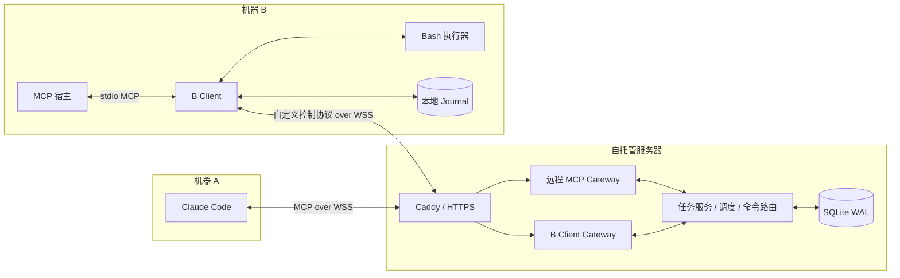

# Claude Task Bridge：自托管 Go 实施计划

日期：2026-10-23

状态：已转为 Go 实现，已完成本轮实现与自动化验证；实际状态以 [验证记录](docs/compatibility.md) 为准。真实 Claude 按用户选择延期验收；目标生产部署/TLS 与实际拟用宿主仍待现场验收。

暂定项目名：`claude-task-bridge`。

## 1. 目标与已经确定的边界

项目运行在普通服务器上，全部应用代码使用 Go。服务端可以部署在已有 Linux 服务器，开发环境在本机运行。

系统有两个使用端：

- **A 端：Claude Code。** 直接连接服务端提供的远程 WebSocket MCP，通过 channel 接收任务，调用远程 `bash` 工具执行命令，并通过 MCP 工具提交任务结果。
- **B 端：本地客户端。** 被其他 MCP 宿主以 stdio 方式加载，既能提交任务并等待结果，也能执行 Claude 发来的 Bash 命令。

本计划采用以下决定：

1. 不使用 Cloudflare Workers、Durable Objects 或其他 Cloudflare 专有运行能力。
2. A 不安装本项目的常驻桥接进程，不使用原生 Bash Hook。A 调用的是服务端的 MCP `bash` 工具。
3. B 必须运行本地执行器。仅连接云端 MCP URL 无法执行 B 的本机命令。
4. 第一版部署一个服务端进程，使用本地 SQLite；不引入 Redis、外部消息队列或多实例集群。
5. 第一版服务于单个所有者，可配置多个设备和工作区；不同设备仍有独立凭据与访问范围。
6. 一个 Claude 会话固定关联一个 B 工作区，同时只处理一个任务；同一个 B 工作区默认也只运行一个任务。
7. 命令执行位置在创建任务时绑定，Claude 不能任意选择另一台 B。
8. 长任务独立于 MCP 请求和 WebSocket 连接存活，断线后可以查询已有状态。
9. 不承诺任意 Bash 副作用的 exactly-once。无法确认执行结果时停止自动重试，并保留恢复信息。

首版成功标准：B 提交任务后，空闲的 Claude 自动收到 channel 通知，在 B 上完成命令执行，然后 B 的 MCP 调用取得持久保存的最终结果。

## 2. Claude Code 兼容性与真实账号验收

目前已核实：

- Claude Code 支持 `type: "ws"` 的远程 MCP 配置，使用 Header 鉴权。
- 本机 Claude Code 2.1.283 的静态实现中，channel 注册检查没有限定传输必须是 stdio。
- channel 需要 capability 声明、会话显式启用及相应的预览期/组织准入。
- 协商为 MCP `2026-07-28` 的连接目前不能注册 channel。

**真实 Claude Code → 远程 WS MCP → B 执行器的端到端验证待完成。** 当前本机 Claude 未登录；用户已明确选择先完成 Go 实现和自动化验证。官方 Go SDK / WS 协议测试作为实现依据，不视为真实 channel 唤醒证明。

P0 验证要求：

1. 使用实际准备运行的 Claude Code 版本和认证方式。
2. 使用锁定版本的官方 MCP Go SDK v1.8.0，正常协商到兼容 channel 的协议；计划目标为 `2025-11-25`。
3. WebSocket 握手接受并回显 `mcp` 子协议，完成 `initialize` 和 initialized 通知后再发送任务。
4. 使用真实 channel 通知触发闲置 Claude，而不只验证 MCP 工具能够列出。
5. Claude 调用远程 `bash`，由 B 返回 hostname、工作目录和随机标记；确认测试文件出现在 B。
6. 验证第二个任务、Claude 忙碌时收到通知以及断线重连后的行为。
7. 记录 Claude 版本、SDK 精确版本、协商协议、启动参数和实际结果，形成兼容性矩阵。

自建 channel 的开发 flag 目前需要交互确认，不应把它设计成未验证的 headless 启动方案。如果目标账号被功能开关或组织策略阻止，明确记录阻断原因；不得静默替换成轮询并宣称 channel 已工作。

依据：[远程 WebSocket MCP][claude-ws]、[channel 接入][claude-channel]、[channel 协议兼容性][claude-channel-protocol]。

## 3. 总体架构



两端都主动连接服务端，A、B 不开放公网端口。服务端提供两个不同协议的入口：

- `/mcp/agent`：Claude 支持的 WebSocket MCP transport，承载 channel 通知和工具调用。
- `/v1/client`：B 使用的项目内部控制协议，承载提交、执行、输出和恢复事件。

WebSocket MCP 是 Claude 支持的自定义 transport，不把它称为 MCP 标准 Streamable HTTP。第一版不额外实现 HTTP MCP 入口；需要兼容其他远程 MCP 宿主时再增加。

所有业务规则只在 domain service 中实现一次，MCP、B 控制协议和管理接口调用相同的业务方法。

普通 Go 服务可以常驻 MCP Server 实例、socket 和等待 goroutine，不需要适配休眠模型。但是内存只保存连接和等待者，任务、执行和结果的事实状态必须在数据库中。

## 4. 技术栈与工程结构

| 部分 | Go 实现 | 说明 |
| --- | --- | --- |
| 语言与构建 | Go 1.26、Go modules | go.mod/go.sum 锁定依赖，CGO_ENABLED=0 构建 |
| HTTP / 日志 / 子进程 | net/http、log/slog、os/exec | 使用 Go 标准库 |
| WebSocket | github.com/coder/websocket | 原生协议实现、消息限额、ping/pong、并发写 |
| MCP | 官方 github.com/modelcontextprotocol/go-sdk v1.8.0 | 原生固定协议 2025-11-25；仅增加 WS framing 与 channel 通知适配 |
| 参数校验 | github.com/google/jsonschema-go | 复用官方 SDK 使用的 schema 库 |
| 数据库 | modernc.org/sqlite + database/sql | 纯 Go SQLite，WAL / FULL；短事务 |
| 数据库迁移 | github.com/pressly/goose/v3 | 嵌入 SQL migrations |
| CLI / 独占锁 / ID | Cobra、gofrs/flock、google/uuid | 复用成熟库，避免自写参数解析、锁与 UUID |
| 系统进程接口 | golang.org/x/sys | POSIX 进程组；Windows 使用系统 taskkill /T /F |
| 指标 | Prometheus Go client | 内部鉴权 metrics 端点 |
| 测试 | testing、httptest、官方 MCP 客户端、真实 Bash | Windows / Linux go test、go vet、race |
| 部署 | Docker Compose + Caddy | 单实例 Go broker、非 root、本地 SQLite |

```text
claude-task-bridge/
  cmd/
    bridge-server/
    bridge-client/
  internal/
    model/
    storage/migrations/
    broker/
    server/
    mcpagent/
    client/
    executor/
  tests/integration/
  deploy/
  examples/
  docs/
  .github/workflows/
  go.mod
  go.sum
```

应用与测试均使用 Go；不保留 TypeScript/Node 运行依赖。实现位于本文件所在的工程根目录；使用入口见 [README.md](README.md)。

依据：[官方 MCP Go SDK][sdk-go]、[Go os/exec][go-exec]。

## 5. 身份、工作区与任务绑定

区分以下标识，不能用一个 `sessionId` 混用：

| 标识 | 含义 |
| --- | --- |
| `principal_id` | 设备或管理员身份，关联凭据与权限 |
| `agent_id` | 一个配置好的 Claude 接入槽位 |
| `executor_id` | 一台 B 的稳定执行器身份 |
| `workspace_id` | B 本地配置的逻辑工作区 |
| `connection_id / generation` | 一次网络连接及其代次，重连会变化 |
| `task_id` | 一个业务任务，与网络连接无关 |
| `assignment_id / lease_epoch` | 任务的一次分派和有效执行授权 |
| `command_id` | 一条持久命令记录 |
| `operation_key` | Claude 对同一逻辑命令重试时复用的业务幂等键 |

B 的配置将 `workspace_id` 映射到真实目录、Shell profile、超时上限和环境配置。服务端保存工作区描述与归属，不能由 A 的工具参数覆盖真实根目录或执行器。

创建任务时根据 B 的身份和工作区确定 `executor_id`。A 的连接只允许领取其配置范围内的工作区任务。

所有 A 工具都验证身份与任务访问权，再按操作类型应用授权规则：

| 操作 | 额外校验 |
| --- | --- |
| bash、progress、complete | 当前连接的有效 assignment/lease 和允许操作的任务状态 |
| accept | 分派仍为 offered，属于该 agent/连接且未过期 |
| get、output、wait | 任务/命令的访问范围；不要求旧执行租约仍有效 |
| resume | 身份、工作区及旧 assignment 归属；允许提交已过期 assignment，但必须核对后重新授权 |
| command_cancel | 对任务的停止权限；允许停止旧分派遗留命令，不因此授予新命令执行权 |

迟到的上一任务执行调用不能借用“当前任务”执行；不得仅靠模型记住任务 ID。

同一个 Claude 会话顺序处理同一工作区任务时保留上下文。跨工作区使用独立 Claude 会话；服务端不会假装能够自动清空 Claude 的上下文。

## 6. MCP 工具契约

统一使用 snake_case 字段；所有时间参数为毫秒，持久时间戳为 UTC。Go 契约位于 `internal/model`，MCP schema 和工具说明由 `internal/mcpagent` 与 `internal/client` 定义。

### 6.1 A 端：远程 MCP 工具

| 工具 | 主要参数 | 返回/行为 |
| --- | --- | --- |
| `task_accept` | `task_id, assignment_id` | 显式接受分派；相同分派重复调用幂等 |
| `task_get` | `task_id` | 返回授权范围内的任务和命令快照 |
| `task_resume` | `task_id, previous_assignment_id` | 请求恢复；先核对 B 状态，不能仅凭重连自动续跑 |
| `bash` | `task_id, assignment_id, operation_key, command, cwd?, timeout_ms?, wait_ms?` | 建立命令记录、路由到 B；快速命令直接返回结果，长命令返回 ticket |
| `command_get` | `task_id, command_id` | 查询状态、退出码、截断信息 |
| `command_wait` | `task_id, command_id, wait_ms?` | 有界等待，不改变命令执行期限 |
| `command_output` | `task_id, command_id, cursor?, limit?` | 分页取得 stdout/stderr |
| `command_cancel` | `task_id, command_id, reason?` | 请求停止本任务的指定命令 |
| `task_progress` | `task_id, assignment_id, message` | 更新面向调用者的进度 |
| `task_complete` | `task_id, assignment_id, outcome, summary, result?` | 提交 succeeded 或 failed；必须没有尚未结束或结果未知的命令 |

`bash` 的工具名在 Claude 中会带 MCP 命名空间，例如 `mcp__bridge__bash`。不模拟或重定向内置 Bash。

`operation_key` 对同一次逻辑命令重试保持不变，例如 `inspect-repository-1`。服务端用 task + operation_key 去重：同键同内容返回现有 command，同键不同内容返回冲突。该机制不能识别模型使用不同 key 发出的语义重复命令，工具说明必须明确未知结果时先查询，不能换 key 重试。

命令结果至少包含：

```json
{
  "task_id": "...",
  "command_id": "...",
  "state": "exited",
  "exit_code": 0,
  "signal": null,
  "stdout": "...",
  "stderr": "...",
  "output_cursor": "...",
  "truncated": false,
  "duration_ms": 1234,
  "cwd": "B 端实际解析的目录"
}
```

非零退出码属于命令结果，保留输出，不能冒充网络或协议失败。工具参数错误、越权、执行器不可用等返回结构化错误：`code, message, retryable, task_id?, command_id?`。

无法启动或结果不明时，`Command.error` 保存受限执行诊断：Code 最多 64 字节，Message 最多 2048 字节；随 command.finished 持久化，并在 journal reconcile 中保留/回传。正常非零退出的命令仍为 exited。

完成结果一旦保存，不允许迟到进度覆盖终态。同一结果重复提交返回成功，冲突结果返回明确错误。

### 6.2 B 端：提供给其他 MCP 宿主的工具

| 工具 | 主要参数 | 返回/行为 |
| --- | --- | --- |
| `tasks_submit` | `workspace_id, prompt, idempotency_key, deadline_ms?` | 服务端提交成功后返回稳定 task_id |
| `tasks_run` | 同上，加 `wait_ms?` | 便利接口：先提交，再等待 |
| `tasks_get` | `task_id` | 查询当前状态和最终结果 |
| `tasks_wait` | `task_id, wait_ms?` | 有界等待，超时返回当前状态和 task_id |
| `tasks_cancel` | `task_id, reason?` | 请求取消；区分取消申请和停止确认 |
| `tasks_list` | `workspace_id?, cursor?, limit?` | 查询授权范围内任务 |
| `tasks_events` | `task_id, after_seq?, limit?` | 分页取得任务进度事件 |

任务被服务端持久化前，不能因为 B 本地缓存了请求就返回“创建成功”。提交响应丢失时，使用相同 idempotency_key 找回任务；同键但不同 prompt/workspace 返回冲突。

### 6.3 等待与进度

- B 的 `tasks_wait` 默认等待 25 秒；上限按宿主验证结果配置，第一版建议不超过 60 秒。
- A 的 `bash/command_wait` 默认等待 30 秒，配置允许时最大 120 秒；宿主 MCP timeout 要留出网络余量。
- 等待超时返回 `pending: true`、当前状态和业务 ID，任务/命令继续。
- MCP 取消当前等待默认只移除 waiter；真正取消业务执行使用明确的 cancel 工具。
- 只有请求提供 `_meta.progressToken` 时才发送对应 MCP progress；未知总量不伪造完成百分比。
- 不依赖 progress 自动延长宿主的硬超时，不要求宿主支持 MCP Tasks 扩展。
- 每次等待都可从数据库重新建立，服务端重启只会中断当前连接，不删除业务任务。

B 的 MCP handler、WS 消息处理与子进程执行必须并发。等待必须使用 context 和独立 goroutine；不得持有全局锁等待最终结果。

## 7. Channel 与 A 会话配置

每条 A WebSocket 连接对应独立 MCP Server 实例。认证先于建立 MCP 会话，能力声明包括：

```json
{
  "tools": {},
  "experimental": {
    "claude/channel": {}
  }
}
```

新任务推送形态：

```json
{
  "method": "notifications/claude/channel",
  "params": {
    "content": "有一个新任务。先调用 task_accept 确认领取，再执行任务。任务内容……",
    "meta": {
      "task_id": "...",
      "assignment_id": "...",
      "workspace_id": "..."
    }
  }
}
```

meta 使用 channel 支持的字符串值和合法 key。工具 instructions 描述领取、远程执行、查询未知结果、显式完成等约定，但授权检查由程序执行。

channel 没有 ACK。服务端写出通知后状态为 offered，只有 `task_accept` 成功才进入 running。重复通知使用相同分派标识，不能产生新的任务或新的命令授权。

A 的配置模板：

```json
{
  "mcpServers": {
    "bridge": {
      "type": "ws",
      "url": "wss://bridge.example.com/mcp/agent",
      "headers": {
        "Authorization": "Bearer ${BRIDGE_AGENT_TOKEN}"
      },
      "timeout": 150000
    }
  }
}
```

启动形态，由兼容性测试确认对应版本的参数行为：

```text
claude --tools "" --strict-mcp-config --mcp-config agent-mcp.json --dangerously-load-development-channels server:bridge
```

`--tools ""` 用于禁用内置工具，只保留指定 MCP 工具。`--allowedTools` 是免审批规则，不是工具白名单，不能替代这一限制。需要免审批时，只为本项目中已授权的 MCP 工具配置规则，不整体跳过权限系统。

A 使用专用协调目录，避免把 A 的其他项目当作 B 的工作区。目标项目文件能力全部位于 B；第一版通过远程 Bash 完成读取和修改。

A 的工具调用响应按当前 MCP 连接关联；连接断开后，不能把旧 JSON-RPC response 直接投递到新连接。恢复依靠 task_id/command_id 查询与新的工具调用。

依据：[CLI 工具限制][claude-cli]、[channel 通知格式][claude-channel]。

## 8. B 控制协议与执行消息

第一版协议版本为 `1`，使用 JSON text frame，字段由 Go 结构、显式边界检查和 MCP JSON Schema 校验。它是本项目的设备控制协议，不复用 MCP 的 server-to-client tool 调用语义。

消息 envelope：

```text
version
type
message_id
request_id?             # 当前请求/响应相关标识
server_epoch            # 区分正常重启与旧数据快照恢复
stream_id
seq                    # 该持久消息流内单调递增
connection_generation
payload                # task_id/command_id 位于相应 payload/args 中
error?                 # 结构化协议/RPC 错误
```

主要消息：

| 类别 | 消息 |
| --- | --- |
| 建连 | hello、welcome |
| 确认与控制 | ack、error、server.draining；连接探活使用 WS ping/pong |
| 业务请求 | rpc、response；承载 tasks_*、command_authorize 和显式 executor_reconcile |
| 命令事件 | command.dispatch、command.accepted、command.started、command.output、command.finished、command.cancel |

连接认证后，B 在 Hello 报告 executor_id、客户端版本、本次配置的 workspaces 子集和 journal stream_id。服务端验证归属与凭据范围；报告集合不能提升权限。未配置工作区的任务保持 queued，新 Bash 请求被拒绝，设备在线不代表全部授权工作区均可执行。

业务状态更新与 outbox 写入同事务提交，再发送消息。接收方先持久化重要消息，再 ACK。Go 实现采用逐 message_id 的 ACK 与持久去重；seq 用于排序与诊断，不作为累计确认游标。取消可以优先于旧 dispatch 重放，未确认消息仍独立保留。累计前缀 ACK 与游标压缩留待后续版本。

broker 与 B 都按连接记录已发送 ID/时间，ACK 只释放对应 ID。未确认消息距上次发送至少 5 秒后才在后续轮次重传；重连使用空的发送集合，立即重放持久未确认记录，不因部分 ACK 或无关状态更新重放整批消息。

WebSocket ping/pong 用于检测连接；业务租约与任务执行期限独立维护。建议 ping 30 秒、连接无响应约 90 秒判失联，具体值可配置。

重连采用带抖动的指数退避，例如 1 秒起步、最大 30 秒。确认旧连接关闭或失活后，新连接增加 generation，旧连接消息被拒绝。旧连接仍健康时，重复连接返回可诊断的 duplicate_session，不允许两个进程无限互踢；需要接管时使用明确的管理操作。

同一 executor/journal 在本机只能由一个 B Client 进程使用。启动时获取跨平台单实例锁，第二个 MCP 宿主加载同一配置时返回 executor_already_running。陈旧锁清理必须核对进程身份，不能只凭一个可能复用的 PID。需要多宿主共享同一 B 时，再实现 daemon/adapter 拆分。

当前实现保留未确认 outbox 并逐条重放；尚不压缩未确认消息，也不使用累计游标或 resync_required。恢复依靠已保存任务/命令与 B journal 的显式对账。

## 9. 状态机与调度

### 9.1 任务状态

```text
queued → offered → running → succeeded
                    │       → failed
                    │
                    ├→ cancel_requested → cancelled / timed_out
                    └→ interrupted → 显式核对并恢复，或结束任务
```

- queued：已持久化，等待匹配的 A 和可用工作区。
- offered：已建立分派，等待 Claude 显式接受。
- running：A 已接受，可以在有效授权下发出命令。
- cancel_requested：冻结新命令，正在确认停止。
- interrupted：执行或会话连续性无法确认，需要恢复处理。
- succeeded、failed、cancelled、timed_out：不可被普通进度更新覆盖的终态。
- abandoned：管理员明确停止追踪一个无法核实的任务；保留未知副作用记录，不代表命令成功或进程已经停止。其处理规则见 12.6。

任务截止到期走停止流程；若 B 离线且进程是否结束未知，保持 cancel_requested 并记录 deadline 原因，不能直接宣称 timed_out 已完成清理。

### 9.2 命令状态

```text
created → dispatched → accepted → running → exited
                                  │       → cancelled
                                  │       → timed_out
                                  └──────→ unknown
```

accepted 表示 B 已记录接收，running 表示已经启动进程。exited 可以包含非零 exit_code。unknown 不自动回到 created，也不自动启动第二次执行。

### 9.3 调度规则

- 任务按工作区 FIFO 排队，A/B 工作区都可用时才分派。
- A 离线时可以接受任务进入 queued，不把离线误报为任务失败。
- 每个 A 槽位和 B 工作区最多一个活动任务；首版不自动分解任务或生成并行 worktree。
- offered 超时且没有执行过命令，可以使旧分派失效并重新排队。
- 已执行过命令的任务不能仅因租约到期自动派给另一个 A。
- 所有状态转换在短事务中校验 revision/epoch，取消、完成和超时只能产生一个最终结果。

## 10. Bash 执行器

### 10.1 支持平台与 Shell

- 服务端首版部署目标：Linux Docker；本地开发可在 Windows/Linux 运行。
- B 首版验收：Linux Bash、Windows 原生 Go + Git Bash。
- Windows 上 Bash 路径显式配置或通过 doctor 确认，不假定所有机器的安装目录相同。
- WSL 的方式是把完整 B Client 运行在 WSL 内，并使用 WSL 路径；第一版不实现从 Windows Go 自动包装 `wsl.exe` 和隐式路径转换。
- macOS 复用 POSIX 路径，但在宣称支持前执行 smoke 与取消测试。
- 不实现 PowerShell 工具、PTY、交互式 stdin 或持久终端会话。

每次调用启动独立 shell，概念形态为：

```text
exec.Command(configuredBashPath, "--noprofile", "--norc", "-c", command)
// Cmd.Dir / Cmd.Env / 平台进程组配置由执行器设置。
```

command 作为一个 argv 参数交给指定 Bash，不额外拼接一层 Shell。`cd`、`export` 仅影响当前调用；下一条命令重新使用明确 cwd 和环境。后台 Shell 命令及自行 daemonize 的程序不属于首版保证的执行语义。

### 10.2 路径与权限

- cwd 省略时使用 B 配置的工作区根目录。
- 相对 cwd 以该根目录解析，检查真实路径、符号链接和平台边界；拒绝无效目录。
- Windows 路径由 B 端 profile 处理，命令内路径按该 Bash 的规则解释，文档给出示例。
- 环境变量由 B 本地配置，服务端不接收 B 的全部环境或允许 A 任意覆盖系统环境。
- 工作区路径检查用于正确路由和避免误操作，**不等同于文件系统沙箱**。任意 Bash 仍具有 B 运行账号的能力；需要隔离时使用专用 OS 账号、容器或其他系统边界。

### 10.3 输出与资源限制

初始默认值作为可配置产品约定，最终由压测调整：

| 参数 | 初始值 |
| --- | ---: |
| 单命令默认执行超时 | 120 秒 |
| 单命令可配置上限 | 15 分钟 |
| 单任务默认 deadline | 30 分钟 |
| 单条 WS 消息上限 | 1 MiB |
| 输出 chunk 原始字节上限 | 32 KiB |
| command_output 参数上限 / 实际原始字节页 | 16 KiB / 最多 8 KiB，另预留 base64 和 JSON 包装 |
| MCP 完整工具结果上限 | 包含包装和元数据，序列化后最多 32 KiB |
| 单命令持久输出上限 | 合计 10 MiB |
| 单任务输出上限 | 合计 50 MiB |
| 每连接待发送内存上限 | 4 MiB |

stdout/stderr 持续 drain，分块并带 stream、chunk_seq。传输层按 bytes/base64 处理，以 base64 原始片段、stream 与 byte offset 分页返回。仅完整有效 UTF-8 提供展示文本；跨页或二进制内容以原始片段为准，避免替换字节丢失。达到输出保存上限后继续 drain，记录截断和丢弃字节数，不因为管道堵塞卡死子进程。

输出超过内联上限时返回尾部摘要和 cursor；后续通过 command_output 分页读取。所有工具结果都执行总量限制，包括 task_get 的命令列表和最终 result，不能只限制 stdout 字段。详细结果分页读取，不要求 Claude 读取 A 上的本地文件。

当前 Claude Code 可能把超过 50,000 字符的成功工具结果保存到 A 本地文件；A 禁用了内置 Read，因此必须避免触发这一自动落盘路径，并用大 ASCII 输出进行真实客户端测试。[MCP 输出限制][claude-output]

stdio MCP 的 stdout 只能写协议消息，日志进入 stderr，Bash 输出必须捕获，不能继承到客户端 stdout。

### 10.4 超时、取消和崩溃

- 执行超时由 B 本地计时器负责，服务端断网也会生效。
- POSIX 取消进程组，先 TERM，宽限期后 KILL；Windows 使用独立的进程树终止实现并实测。
- 以进程 close 和输出流结束确认完成，不能只在发送 kill 或收到 exit 时结束记录。
- 对未能确认的停止返回 stopping/unknown，不能返回已取消。
- 正常退出 B Client 时停止接收任务并终止管理的子进程。
- B 崩溃后从 journal 恢复；不能只凭旧 PID 自动杀进程，防止 PID 已被复用。
- 首版不承诺强制终止任意脱离进程组的后台程序；需要此保证时再引入 OS Job/cgroup 等隔离能力。

依据：[Go os/exec][go-exec]。

## 11. 数据模型与持久化

服务端 SQLite 启用 WAL、foreign_keys、合理 busy_timeout，重要提交使用 `synchronous=FULL`。所有事务保持短小，不在事务内等待网络、Claude 或 Bash。数据库放本地块存储，不放 NFS/SMB。

| 表 | 主要字段与约束 |
| --- | --- |
| `principals` | id、kind、token_hash、scopes、disabled_at |
| `workspaces` | id、executor_id、name、policy_version、description、quarantined_at/reason |
| `agents` | id、principal_id、workspace_id、配置能力 |
| `connections` | id、principal_id、generation、connected_at、last_seen_at |
| `tasks` | id、requester_id、workspace_id、executor_id、prompt、state、revision、idempotency_key、request_hash、deadline_at、result/error |
| `assignments` | id、task_id、agent_id、connection_id、lease_epoch、lease_until、state |
| `commands` | id、task_id、assignment_id、operation_key、request_hash、command、cwd、timeout、state、exit_code、signal、时间戳 |
| `command_chunks` | command_id、chunk_seq、stream、bytes、唯一约束 |
| `events` | seq、task_id、command_id?、type、payload、时间戳 |
| `outbox` | id、recipient_id、event_seq、payload、acked_at |
| `peer_cursors` | peer、stream、last_ack；当前用于 executor 与 B journal stream 的持久绑定，last_ack 不充当累计确认游标 |
| `resolutions` | task_id/command_id、操作者、理由、现场证据、核对结果、时间戳；保留原始 unknown 记录 |
| `goose_db_version` | Goose 管理的迁移版本与应用时间 |

关键唯一约束：

- `(requester_id, idempotency_key)`：提交去重，同时检查 request_hash。
- `(task_id, operation_key)`：命令去重，不因为换了 assignment 就失去历史去重记录。
- `(command_id, chunk_seq)`：输出重放去重。
- 设备消息的稳定 message_id：重复 finished/ACK 不重复更新结果。

活动任务和 assignment 约束由事务及唯一约束共同保证，不能只靠内存布尔值。

B 使用独立本地 SQLite journal，保存已接受命令、启动记录、结果、输出和待确认消息。先记录接收再 ACK，服务端确认最终结果已持久化后，B 才能按保留策略清理。

数据库只保存必要结果和有界输出。首版不实现任意附件上传服务；任务产物以 B 工作区内路径和说明返回。需要跨机器下载产物时再加入有鉴权的附件协议。

保留策略初值：命令完整输出 7 天，B 上已被服务端确认的输出 3 天；任务摘要、幂等与审计元数据保留以避免重复执行，受数据库总容量限制；未确认和 unknown 记录不按普通已完成记录自动删除。服务端默认 2 GiB、B journal 默认 1 GiB，均预留 16 MiB 记录终态；磁盘可用空间不足时拒绝新工作。

依据：[SQLite WAL][sqlite-wal]。

## 12. 断线、租约与恢复

### 12.1 基本语义

系统保证至少一次消息投递，并在接收端持久去重。业务任务与命令 ID 独立于 MCP request id、WebSocket 连接和进程 PID。

已经确认的命令结果重放时返回同一结果。执行结果未知时进入 interrupted/unknown，不用重新执行来掩盖不确定性。

### 12.2 A 断线

- 立即冻结该连接的新命令授权。
- 服务端保留任务、assignment 和已执行命令。
- 已启动 Bash 默认按既定超时继续执行，结果由 B 保存并回传。
- 相同 agent 凭据重连不证明是同一个 Claude 会话，不自动恢复 running。
- 通过任务恢复通知和 task_resume 显式查询快照、核对当前命令；确认可恢复后创建新 assignment，旧 assignment 失效。
- 若 Claude 上下文丢失，任务保留为 interrupted，由调用方决定结束或发起新的任务。

### 12.3 B 断线或崩溃

- 网络断开时本地进程可继续，输出进入有界 journal；恢复后重传。
- 服务端不因 B 离线就把 Bash 认定为失败。
- B 重启后先核对 journal；已完成记录回传，运行状态无法确认的命令标记 unknown。
- journal 在记录“准备启动”后进程是否真正启动存在崩溃窗口；不能仅凭 accepted 状态自动再启动。

### 12.4 服务端重启

- 启动检查数据库、迁移和存储空间，加载未完成任务、outbox 和超时索引。
- 旧网络连接全部视为失效，等待 A/B 重新认证并报告状态。
- 已完成任务可以立即查询；运行中任务先进入核对流程，不自动回到 queued。
- B 的完成事件重复到达时幂等保存并 ACK。
- 服务端内存 waiter 丢失不会丢任务；客户端以业务 ID 重新查询。

### 12.5 取消与租约

lease 用于阻止旧 A 发出新命令，不能撤回已经执行的副作用。初值可采用活跃任务每 20 秒续约、60 秒租约；网络心跳不等价于模型在取得进展，任务 deadline 独立生效。

发给 B 的 dispatch 带 task、assignment/epoch、有效期和命令 deadline。B 在启动前核验当前控制连接、授权范围和有效期；已过期或已撤销的派发不能启动新进程。已经运行的命令按自己的 timeout/取消规则结束，租约失效不会自动重跑它。

取消先记录 cancel_requested，废止新命令授权，再给 B 发停止请求。只有所有相关命令确定结束后，才进入 cancelled/timed_out。

若 B 离线，返回取消仍待确认；重连后优先发送取消，不能先重放普通执行指令。B 持久化取消 tombstone，即使取消先于对应 dispatch 到达，后续迟到的 dispatch 也不会启动进程。

### 12.6 未知结果的人工处理

unknown 不能成为永久占据工作区且无法处理的死路。提供受管理权限保护的处理流程：

1. 管理员查询命令、B journal 和现场进程，记录核对理由与证据。
2. 若能确认退出或从未启动，追加 resolution，保留原始不确定状态的历史，不伪造 exit_code。
3. 若无法确认副作用，可以明确 abandon 任务，返回带 unresolved 标记的最终业务结果；该动作不会宣称进程已经停止。
4. 对仍可能存在旧进程的工作区保持 quarantine，调度器不得继续分派任务。
5. 管理员核实旧执行已停止，或重新建立隔离的执行环境后，单独解除 quarantine。任务结案与工作区恢复可用是两个动作。

这些操作必须留下操作者、理由、时间和证据，不提供自动把 unknown 改成成功的路径。task_resume 遇到未解决的 unknown 返回 reconciliation_required。

## 13. 鉴权与操作边界

- 初版使用独立设备 Bearer token，A/B/admin 分角色，不共享万能凭据。
- token 为高熵随机值，服务端只保存哈希；签发后只展示一次，可吊销。
- 在 WebSocket upgrade 前校验 token 和 scope；吊销同时关闭已有连接。
- A token 仅可访问绑定 agent/workspace；B token 仅可提交自己的工作区任务和回传自己的命令结果。
- 拒绝用户在参数中伪造 executor、workspace、assignment 或 connection generation。
- 默认关闭匿名入口，管理接口不向公网开放。
- 日志脱敏 Authorization、token 等字段，常规运行日志不复制完整命令输出和任务正文。
- 对握手、消息、排队任务数、输出和工具参数设置上限，防止异常客户端耗尽内存或磁盘。
- 任意 Bash 在 B 配置账号的权限下执行，B 的本地配置决定允许范围。若产品面向不互信用户，必须另做执行隔离和多租户方案。

第一版不实现 OAuth/OIDC 登录流程、浏览器管理 UI 或 channel 远程权限审批转发；账号/设备配置由 CLI 完成。

## 14. 配置与命令行交付

提供两份发布包：

- `bridge-server`：启动服务、配置检查、设备管理、迁移、备份和恢复。
- `bridge-client`：B 的 stdio MCP 服务、连接检查和本地执行器。

计划中的命令形态：

```text
bridge-server serve --config server.json
bridge-server admin devices create --kind claude --workspace <id>
bridge-server admin devices create --kind executor
bridge-server admin devices revoke <id>
bridge-server admin tasks inspect <task_id>
bridge-server admin commands resolve <command_id> --outcome <verified-outcome> --reason <text>
bridge-server admin tasks abandon <task_id> --reason <text>
bridge-server admin workspaces release <workspace_id> --reason <verified-stopped-evidence>
bridge-server admin backup --output <path>
bridge-server migrate --config server.json

bridge-client mcp --config client.json
bridge-client doctor --config client.json
bridge-client reconcile --config client.json --reason <reviewed-evidence>
```

运行中的 admin 命令通过受保护的本机管理通道访问 broker，使吊销等操作立即影响内存连接。离线迁移/恢复时要求 broker 停止，避免不受控的第二写进程。

B 配置包括：服务端 URL、凭据来源、executor ID、本地 journal 路径、工作区别名与根目录、Bash 路径、环境透传列表、资源上限。凭据不放命令行参数中。

`doctor` 输出配置和依赖是否满足、服务端是否可达、Shell profile、工作区是否有效，不打印 token 或完整环境。主动执行 Shell 探针属于显式诊断模式，普通配置检查不修改工作区。

`bridge-client mcp` 生命周期默认跟随宿主。宿主关闭或 stdin EOF 时停止新任务并清理执行进程；如果要求宿主退出后仍继续运行，需要后续拆分 daemon 与 stdio adapter。

## 15. 服务器部署与维护

### 15.1 Docker Compose

两个常驻服务：

1. `broker`：单 Go 进程、非 root、本地 SQLite 持久卷，只向 Compose 内网监听。
2. `caddy`：公开 80/443、自动 TLS、证书数据持久卷，反向代理到 broker。

首版不使用多进程 cluster、不设置多个 broker replicas，不把 SQLite 放共享网络盘。后续确需 HA 时，再评估 PostgreSQL、跨进程连接路由和消息协调。

初始资源规划可从 1 vCPU、1 GB RAM 的已有 Linux 服务器起步，推荐预留 2 GB RAM；这只是测试基线，不是已验证容量承诺。主要计算发生在 A/B，服务端负载来自 JSON、SQLite 和输出传输。

需要持久化：SQLite 数据目录、Caddy 证书数据、配置和备份。容器镜像使用明确版本，部署不自动跟随 latest。

### 15.2 HTTP 路由

| 路由 | 用途 |
| --- | --- |
| `GET /healthz` | 进程存活 |
| `GET /readyz` | 数据库可用、迁移完成、未进入 drain |
| `GET /mcp/agent` upgrade | A 的远程 MCP |
| `GET /v1/client` upgrade | B 控制协议 |
| 内网 metrics/admin | 监控与管理，不公开设备凭据和任务内容 |

Caddy 配置要允许 WebSocket upgrade，并通过 reload/超时测试。代理 reload 也可能断开连接，客户端恢复流程必须覆盖这一情况。

### 15.3 关闭、升级与恢复

优雅关闭顺序：readiness 失败 → 停止新任务/分派 → 通知 draining → 完成当前短事务和必要发送 → 关闭连接和数据库 → 退出。不等待全部 Claude 任务完成才关机。

升级前执行一致性备份；迁移失败不进入 ready。初版采用前向迁移，不实现自动 down migration。

备份使用 SQLite online backup API 或一致性快照方式，不在运行时只复制 `.db` 而忽略 WAL。备份复制到另一磁盘或主机，定期在空目录恢复并执行 integrity check。

恢复旧备份会丢失备份之后的去重记录，因此恢复工具必须执行以下专门流程（恢复到一个新数据库路径，保留原数据库与备份）：

1. 冻结派发、断开旧连接，将恢复后的所有未完成任务（包括备份时仍 queued 的任务）标记为 interrupted 并隔离工作区；不得直接重放旧 outbox。
2. 生成全新的 server_epoch 和消息流 stream_id，废止旧 connection generation 与 ACK 游标，防止客户端把恢复后重新生成的序号当作旧消息丢弃。
3. 默认废止从备份恢复出的全部设备 token，并重新签发，避免复活备份之后已经吊销的凭据。
4. B 保留本地 journal。停止 B 后，用新凭据运行 `bridge-client reconcile --config client.json --reason <核对证据>`；逐批比对原执行指纹，归档原 pending/unknown 证据与 orphan，再原子切换本地 epoch。已知结果补传，快照中不存在的命令只保留证据，不重建可执行工作。隔离仍需管理员另行核实解除。
5. 对去重历史已不完整的任务保留不确定性，不能把“服务器没有记录”理解为命令没有执行过。

普通进程重启保持原 server_epoch/持久消息流；只有数据回滚或显式恢复才进入上述流程。恢复出的旧 queued 任务没有原 assignment，需管理员 abandon 后按需重新提交；不能通过 task_resume 自动重跑。

首版运维目标：提供可执行备份/恢复流程并记录实测 RPO/RTO；不承诺无停机或零数据丢失。

依据：[Caddy WebSocket 代理][caddy-proxy]、[SQLite 在线备份][sqlite-backup]。

## 16. 可观测性与容量保护

每条运行日志携带适用的 task_id、command_id、agent_id、executor_id、connection_id 和 assignment_id；业务正文保存在授权的数据路径中，不重复输出到普通日志。

至少提供以下指标：

- 在线 A/B 数、连接重连次数、认证失败。
- queued/offered/running/interrupted 任务数、排队与完成耗时。
- running/unknown 命令数、执行超时和取消耗时。
- WS bufferedAmount、发送队列积压、输出截断字节。
- SQLite 写延迟、busy/磁盘满错误、数据库大小。
- outbox 未确认数和最老记录年龄。

磁盘空间不足时先拒绝新任务/命令，保留处理已有命令终态的空间；输出配额用明确截断状态反馈。不能无限累积等待者、日志或重连缓存。

第一轮压测目标：在指定测试机器上模拟至少 5 个 A、10 个 B，验证连接与任务串行约束、慢消费者和大输出下内存有界。记录服务端自身处理延迟，避免把 Claude 推理时间混入 broker 性能指标。

已完成 5 A/10 B 小规模协议联调与离散内存采样。另有真实 WS 慢消费端回归：停止读取后被断开，100 条各约 32 KiB 的未确认消息保留，正常读取方重连后全部重放并逐 ID 确认；Windows/Linux race 通过。该结果不覆盖所有持续压力、网络限速与数据库故障组合。

## 17. 测试与故障验收

单元测试集中在状态转换、权限、路径解析和幂等边界。核心交付依靠真实 SQLite、WebSocket 和子进程集成测试；mock MCP 客户端不能代替真实 Claude channel 测试。

| 场景 | 必须观察到的结果 |
| --- | --- |
| 正常闭环 | B submit → A channel → B Bash → A complete → B waiter 返回 |
| 等待期间执行 | B 的 tasks_wait 未返回时仍能执行 A 的 Bash，无全局锁死 |
| 执行位置 | hostname/随机标记和文件证明命令在 B；A 内置执行工具不可用 |
| 重复任务提交 | 相同 idempotency_key 同内容只创建一个任务；不同内容冲突 |
| 重复命令 | 相同 operation_key 只产生一次执行效果，返回同一 command_id |
| 旧分派 | 旧 assignment、错 task、跨工作区或其他设备身份调用被拒绝 |
| Broker 崩溃 | 在 DB commit、send、ACK 前后分别崩溃，恢复不丢已确认结果、不盲目重跑 |
| B 执行崩溃窗口 | 不能确认是否执行时进入 unknown，而不是自动重试 |
| B 断网 | 子进程按既定期限运行，本地有界保存输出，恢复后补传 |
| A 重连 | 旧 RPC response 不投递到新会话；显式恢复后才允许新命令 |
| 取消竞态 | 自然完成与取消同时发生只有一个稳定终态 |
| 离线取消 | 显示待确认，不把断网当作进程已经终止 |
| 超时 | B 离线于服务端时仍能按本地超时结束命令 |
| 子进程树 | Linux 和 Windows 分别验证前台子进程及其普通子孙被停止 |
| PID 复用 | 恢复时不按过期 PID 杀掉无关进程 |
| 输出处理 | 中文/UTF-8 跨 chunk、非零退出码、stderr、超大输出均保持协议完整 |
| MCP stdio | B 的日志与 Bash 输出不污染 stdout JSON-RPC |
| A 大工具输出 | 60 KB ASCII 输出通过服务端分页取得，不变成 A 无法读取的本地文件引用 |
| 双宿主启动 B | 同一 executor/journal 第二个进程明确失败，不互踢、不并发执行 |
| 取消先于派发 | cancel tombstone 阻止迟到 dispatch 启动进程 |
| unknown 人工结案 | 可审计地结案；旧进程未确认结束时工作区继续隔离 |
| 慢消费者 | 网络变慢时队列和内存有上限，截断/背压行为可观察 |
| Channel 准入 | feature/allowlist/组织策略拒绝时有明确诊断，不假装接受任务 |
| Caddy reload | 两端重连，已执行命令不被再次启动 |
| 数据库故障 | 磁盘满或迁移失败时不 ready 或拒绝新工作，不确认未持久化结果 |
| 备份恢复 | 一致快照可恢复、integrity check 通过，消息流代次刷新，旧任务先核对再恢复 |
| 旧备份凭据 | 已吊销 token 不因还原旧 principals 数据再次可用 |
| 凭据吊销 | 旧连接立即失效，重连和任务访问被拒绝 |

CI 在 Linux 与 Windows 上执行 go vet、构建、状态/协议测试和客户端执行器集成测试。真实 Claude channel smoke 单独记录版本和人工准入步骤，不把需要真实账号的测试伪装成无凭据 CI。

## 18. 分阶段实施与交付物

按依赖顺序推进。代码与自动化验证可独立进行；真实 Claude channel、真实宿主和生产部署保持独立验收，不因协议测试通过而自动勾选。用户已确认先完成实现和自动化验证，真实 Claude 验收留待后续。

### P0：远程 MCP Channel 可行性验证

- [x] 建立最小 Go WS MCP server 和 Transport adapter。
- [ ] 用真实 Claude 完成握手、channel 推送、测试工具调用。
- [ ] 通过临时 B 执行器验证 hostname、pwd 和随机标记。
- [ ] 验证无 A 本地 Bash、重复任务通知、忙碌通知和重连。
- [x] 锁定版本并写 compatibility.md。

交付：可重复运行的 smoke 原型、兼容性记录、明确的通过/失败结论。

### P1：工程骨架与持久领域模型

- [x] 建立 Go module、构建、go vet 和 CI。
- [x] 定义 contracts、状态机、错误码和配置 schema。
- [x] 建立 SQLite migration、事务封装、唯一约束和 outbox。
- [x] 实现设备凭据、workspace 绑定及内部管理通道。
- [x] 完成任务状态/幂等/越权测试。

交付：可启动的服务端基础、数据库迁移和领域测试。

### P2：B Client 与本地执行器

- [x] 实现 stdio MCP 和到服务端的独立 WS 连接。
- [x] 实现 journal、输出分块、受限缓存与执行器。
- [x] 完成 Linux Bash 与 Windows Git Bash profile。
- [x] 实现执行超时、取消、进程 close 和 journal 记录。
- [x] 验证 B 等待任务时仍能执行命令。

交付：可被 MCP 宿主加载的 B 包、执行器测试和配置示例。

### P3：完整任务闭环

- [x] 完成队列、offered/accept、单会话/单工作区约束。
- [x] 实现 A 的 bash、命令查询与任务结果工具。
- [x] 实现 B 的 submit/run/get/wait/cancel/list/events。
- [x] 完成命令路由、结果持久化、进度与有界等待。
- [x] 官方 MCP 协议测试端驱动真实 B 命令，完成包含检查、修改和验证的多步任务；真实 Claude 另行验收。

交付：单服务器开发环境的功能闭环；明确此时尚未完成故障恢复验收。

### P4：恢复与一致性

- [x] 完成 ACK/replay、连接 generation、lease 和显式 resume。
- [x] 完成 duplicate/unknown/interrupted 处理。
- [x] 完成人工 resolution/abandon 与 workspace quarantine 的闭环。
- [ ] 完成 Broker/B 崩溃窗口故障注入。
- [x] 完成取消、超时、断线和迟到结果竞态测试。
- [x] 验证输出/数据库配额，以及慢 WS 消费端断开、未确认消息持久保留与重连重放场景。
- [ ] 完成持续压力及其他慢消费者/数据库故障组合验收。

交付：可恢复的 MVP，故障矩阵中核心执行项全部通过。

### P5：自托管部署与运维

- [x] 提供 Dockerfile、Compose、Caddyfile 和环境模板。
- [x] 配置非 root、持久卷、health/readiness、优雅退出。
- [x] 提供管理 CLI、备份、恢复和升级步骤。
- [ ] 完成 HTTPS/WSS、代理 reload、服务重启和恢复演练。
- [x] 验证旧快照恢复时消息流绑定重置、设备凭据失效及 B journal 对账。
- [x] 补齐指标、限额与诊断日志。

交付：可在普通服务器安装的版本及运维文档。

### P6：发布与最终验收

- [ ] 在干净机器上按文档部署服务端并配置 A/B。
- [ ] 在实际拟用 B MCP 宿主中完成端到端任务。
- [x] 记录支持的平台、Claude/SDK 版本、已知限制和恢复方式。
- [ ] 发布锁定依赖的客户端包与服务端镜像，记录镜像 digest。
- [x] 记录 5 A / 10 B 小规模联调与离散内存采样、保留策略；持续容量上限另行测试。

交付：首个可使用版本、验收记录和升级说明。

实施顺序：P0 的 SDK/WS 协议验证 → P1 → P2/P3 → P4 → P5 → P6 的本地产物验证。真实 Claude P0 与实际宿主/部署验收仍为对外宣称可用的前置条件；本轮按用户明确选择继续完成可独立验证的实现。

## 19. 第一版完成定义

第一版需要同时满足：

- A 只配置远程 MCP/channel 即可工作，不依赖项目本地适配器。
- B 以 stdio MCP 方式加载，提交任务、等待结果和执行 Bash 能并发运行。
- 命令与文件操作实际发生在 B 的指定工作区。
- 结果可在调用超时、连接中断和服务端重启后重新查询。
- 重复投递不会重复启动同一 command；执行不确定性会明确呈现。
- 取消、超时、日志截断和各端退出的语义有测试覆盖。
- 服务可通过 Compose + Caddy 部署，具备一致备份和恢复步骤。
- 文档明确 channel 预览期准入、支持版本、Windows profile 和后台进程限制。

## 20. 后续范围

以下不作为首版前置条件：

- B daemon 与 stdio adapter 拆分，让宿主退出后继续执行。
- Web 管理界面、OAuth/OIDC、完整多租户及计费。
- 自动挑选多个 Claude agent、并发 worktree、任务依赖图。
- PostgreSQL、多实例、HA 与跨服务器连接路由。
- HTTP Streamable MCP 和 MCP Tasks 扩展。
- PTY、交互式 stdin、持久 Shell、PowerShell 工具。
- 专用远程文件工具、附件上传下载和对象存储。
- 面向不互信任务的容器/OS 沙箱。
- 独立的 headless Agent SDK runner；它是另一种接入方式，不直接冒充 channel。

## 21. 参考资料与证据边界

本计划中的产品约束依据下列官方资料。架构、默认限额和数据模型是本项目的设计选择；版本兼容性、资源占用和完整恢复行为仍需按阶段实测。

- [Claude Code 远程 WebSocket MCP][claude-ws]
- [Claude Code Channels reference][claude-channel]
- [Channel 与 MCP 协议兼容性][claude-channel-protocol]
- [Claude Code CLI 工具配置][claude-cli]
- [官方 MCP Go SDK][sdk-go]
- [MCP 自定义 transport][mcp-transports]
- [MCP progress][mcp-progress] 与 [cancellation][mcp-cancellation]
- [Go os/exec][go-exec]
- [SQLite WAL][sqlite-wal] 与 [在线备份][sqlite-backup]
- [Caddy reverse_proxy][caddy-proxy]

[claude-ws]: https://code.claude.com/docs/en/mcp#option-4-add-a-remote-websocket-server
[claude-channel]: https://code.claude.com/docs/en/channels-reference
[claude-channel-protocol]: https://code.claude.com/docs/en/mcp#push-messages-with-channels
[claude-cli]: https://code.claude.com/docs/en/cli-reference#cli-flags
[claude-output]: https://code.claude.com/docs/en/mcp#mcp-output-limits-and-warnings
[sdk-v1]: https://github.com/modelcontextprotocol/typescript-sdk/tree/v1.x
[mcp-transports]: https://modelcontextprotocol.io/specification/2025-11-25/basic/transports#custom-transports
[mcp-progress]: https://modelcontextprotocol.io/specification/2025-11-25/basic/utilities/progress
[mcp-cancellation]: https://modelcontextprotocol.io/specification/2025-11-25/basic/utilities/cancellation
[node-releases]: https://nodejs.org/en/about/previous-releases
[node-child-process]: https://nodejs.org/api/child_process.html
[sqlite-wal]: https://www.sqlite.org/wal.html
[sqlite-backup]: https://www.sqlite.org/backup.html
[caddy-proxy]: https://caddyserver.com/docs/caddyfile/directives/reverse_proxy#streaming

[sdk-go]: https://github.com/modelcontextprotocol/go-sdk
[go-exec]: https://pkg.go.dev/os/exec
