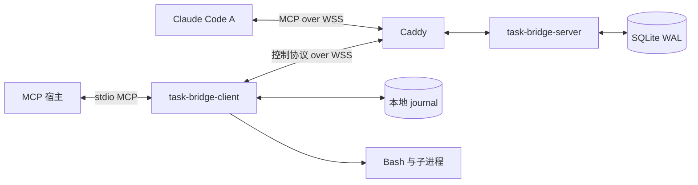

# 架构

应用统一使用 Go。一个 broker 进程维护在线连接与短期等待者，SQLite 保存业务事实。A/B 都主动连接服务端；工作区命令在 B 执行。

## 组件与库

| 组件 | 实现 |
| --- | --- |
| HTTP 与管理 API | Go `net/http` |
| A 的 MCP、B 的 stdio MCP | 官方 `github.com/modelcontextprotocol/go-sdk` |
| 自定义 WebSocket transport | `github.com/coder/websocket`，连接到 SDK transport 接口 |
| 状态与 journal | `database/sql` + `modernc.org/sqlite` |
| 数据库迁移 | `github.com/pressly/goose/v3`，SQL 嵌入应用 |
| 单实例锁 | `github.com/gofrs/flock` |
| 命令行 | `github.com/spf13/cobra` |
| 监控 | `github.com/prometheus/client_golang`，受管理鉴权保护的 `/metrics` |
| 进程执行 | Go `os/exec` 与平台进程控制 |

服务端不需要 Bash、Node.js、Redis 或外部消息队列。B 需要已安装的 Bash。使用纯 Go SQLite 驱动，常规构建可关闭 CGO；race 检测仍需要对应平台的 race 工具链。

## 入口与身份

| 入口 | 用途 | 凭据 |
| --- | --- | --- |
| `/mcp/agent` | A 的远程 WebSocket MCP | Claude 设备 token |
| `/v1/client` | B 的版本化 JSON 控制协议 | executor 设备 token |
| `/healthz`、`/readyz` | 进程与数据库探针 | 无设备凭据 |
| 独立的 `admin_listen` | 设备、任务、备份等本机管理 | 管理 token |

A 的 transport 是 Claude 支持的远程 WebSocket MCP，自定义适配只负责 JSON-RPC 消息传输，不自行实现 MCP 工具协议。它不等同于 MCP 标准 Streamable HTTP。

每个设备凭据关联独立 principal；A 还绑定 `agent_id`，B 绑定稳定 `executor_id`。workspace 绑定 executor。任务创建时固定执行位置；A 的工具参数不能重选 executor 或改变本地工作区根目录。

B 在 Hello 中报告本次实际配置的工作区子集，服务端核对归属与凭据范围，并将其保存在连接上。在线 B 没有报告的工作区不会获得新任务分派或新 Bash 授权；已有排队任务继续保持 queued。

`task_id`、`command_id` 在连接间保持稳定。`connection_id`、generation、assignment 与 lease 属于一次授权。查询历史结果不需要延续旧租约，发出新命令必须通过当前分派校验。

## 正常任务闭环

1. B MCP 工具提交任务；broker 在 SQLite 提交成功后返回 `task_id`。
2. 调度器选择匹配且空闲的 A 和 workspace，持久化分派，发 channel 通知。
3. A 调用 `task_accept`；只有接受成功才获得命令授权。
4. A 的 `bash` 请求建立持久命令，通过 B 控制连接派发。B 先写 journal，再启动 Bash。
5. B 分块保存输出与终态并上传。broker 保存后确认，MCP 工具可以等待或分页查询。
6. A 调用 `task_complete`；broker 保存不可变的最终结果，B 等待者读取同一份结果。

channel 通知没有业务 ACK，`offered` 与 `running` 分开。长任务不依赖某一个 MCP 请求持续打开。B 的网络读取、MCP handler、等待者和进程执行并发运行。

## 持久化与恢复原则

任务提交按 requester、workspace、`idempotency_key` 去重；命令按 task、`operation_key` 去重。同键同请求读取原记录，同键不同请求冲突。去重只覆盖同一逻辑 key，不能识别模型换 key 后的语义重复命令。

重要状态变化与待发送记录必须先保存再发送。网络送达不代表对方已经持久化。连接恢复依靠 journal、快照与稳定业务 ID核对，不能把旧 JSON-RPC response 投递到新 MCP 会话。

两端按 message ID 分别确认，并为每条连接记录已发送消息。ACK 只释放对应 ID，未确认消息至少间隔 5 秒才重传；重连后立即重放持久待确认记录。`peer_cursors` 当前承担 executor 与 B journal stream 的持久绑定，不用作累计确认游标。

进程启动前后存在无法用数据库事务覆盖的崩溃窗口。journal 表示准备启动时，实际进程可能已经存在；恢复不能自动再启动。无法确认执行结果的命令进入 `unknown`，任务进入待核对状态并隔离工作区。

普通 broker 重启应保留已有 `server_epoch`。恢复旧数据库备份属于数据回滚，需要刷新 epoch/消息流、废止恢复出的设备凭据，并与 B journal 核对。实际实现与演练范围见 [compatibility.md](compatibility.md)；未完成的恢复验收不能被普通重启测试替代。

## 状态与取消

任务包括 queued、offered、running、cancel_requested、interrupted 及 succeeded、failed、cancelled、timed_out、abandoned 终态。命令包括准备、运行、确定结束及 unknown 等状态，具体字段见 [protocol.md](protocol.md)。

命令的结构化执行诊断随终态和 journal 对账保存，错误码最多 64 字节、消息最多 2048 字节。正常非零退出仍为 exited，保留退出码和输出。

取消首先冻结新命令，再要求 B 终止已启动的进程。B 离线时取消仍待确认。只有确定相关命令结束后，任务才能成为 cancelled 或 timed_out。人工 abandon 只结束业务追踪；旧进程未核实时 workspace 继续隔离。解除隔离需要单独的管理操作和核对理由。

## 执行边界

每条命令使用独立 Bash 进程，不保存 shell 工作目录或环境。B 解析相对 cwd 并检查 workspace 根目录范围。环境透传和超时由本地配置控制。进程树终止与 Windows 路径转换依赖平台实现，验证状态单独记录。

工作区路径检查不阻止 Bash 自身访问该账号有权访问的其他资源。面向不互信用户时，需要额外的容器或操作系统隔离；本版定位为单个所有者的设备协作。

服务端限制消息、排队任务、输出分页与本地输出保存。超额输出必须返回截断信息。SQLite 和 journal 使用本地磁盘；不以共享网络目录承载多 broker 写入。
